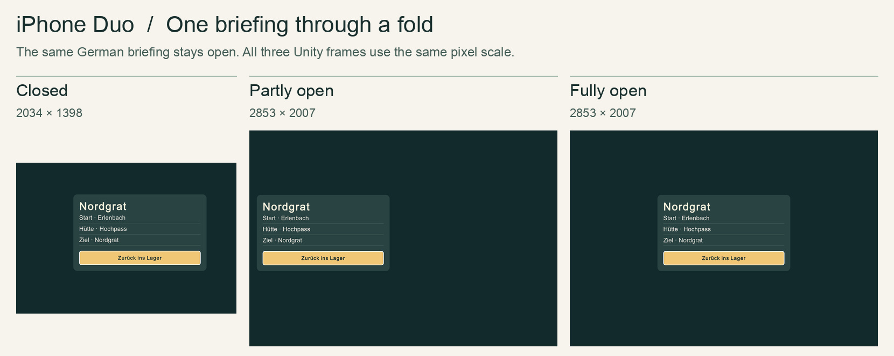

# iPhone screen adaptation in Unity UI Toolkit

All ten Charge Pulse sample screens ran on iPhone Duo. With resizable scenes enabled, the mounted briefing moved into one pane when the device folded and recentered across the inner display when it opened flat. Its Back action kept focus throughout the round trip.



[All ten screens on the Duo](duo-screens.jpg) · [Six iPhone Players side by side](iphone-family.jpg) · [Machine-readable results and source hashes](results.json)

## Verification scope

| Runtime | What ran |
| --- | --- |
| Unity 6000.6.7f1 arm64 Players on iOS 27.2 Simulator | Two independent runs on iPhone 17e, 17, Air, 18 Pro, 18 Pro Max and Duo. Each verified 240 primary screen cases and decoded 273 Unity captures. Each Duo run also captured four Simulator display images. |
| Third-generation iPhone SE Player | Ten screens in three orientations plus a retained-page rotation and two proportional-size baselines. All 34 Unity frames verified. |
| UIKit observers | A full-screen scene measured 11 named iPhones in portrait and both landscape directions. A continuously mounted Duo scene also measured the sensor-confirmed closed, partially open, flat and restored poses. |
| Unity Editor Play Mode | The original 25 profiles and 61 additional iPhone profiles exercised ten screens in English and German. The additional set comprises 27 measured phone geometries, four ordered Duo fold records, 21 published historical geometries and nine deliberately synthetic cases. |

Across these sources, **29 iPhone models** are named. Seven ran the Unity Player, four more supplied live UIKit window geometry, and 18 supplied published Unity device profiles. The main device matrices exercised 480 primary cases. After the final map-toolbar change, the rebuilt Player verified both zoom controls across nine Duo states and three SE states. The results file identifies the binaries and source inputs used for each test.

The original 25-profile suite produced 500 primary screen and locale combinations and 914 captures. Each 61-profile suite produced 1,220 primary combinations and 2,201 captures. Seven screen families reproduced byte for byte across every captured state. Expedition and Preferences showed color differences during button transitions, and the HUD differed by at most one RGB level. Geometry, text alignment, input and localization checks passed. The isolated final Waypoint runs passed on all 86 profiles in both languages.

## Screens and controls

| UI | Examples exercised across sizes |
| --- | --- |
| Expedition menu and briefing | Full-screen navigation, return, focus and retained page through a fold |
| Touch controller | Joystick travel, pointer capture, Pause and Pulse |
| Gameplay HUD | Corners, status title, progress, focus, pressed and reduced-motion feedback |
| Waypoint map | Zoom, world-to-panel projection, dragging and removal of redraw callbacks |
| Inventory | Six instances of a shared card, responsive grid and accessible reordering |
| Trail atlas | Virtualized rows, filtering, compact detail, wide master-detail, sheet and drawer |
| Settings overview | Stacked or side-by-side cards and aligned label/value rows |
| Preferences | Tabs, fields, popover, modal, save notification and fixed actions |
| Confirmation dialog | Both localized actions and the separately rendered Canvas equivalent in the Editor |
| Trail journal | Fixed header and footer, reading position and last scroll item |

The [screen and child-state inventory](../UI-CASES.md#screens-and-controls) links each case to its UXML. The native Player uses German, mounts the same UXML and exercises the primary action or read-only subject. The Editor also exercises the child states in both locales.

## What changes through a Duo fold

The independent UIKit observer produced these top-left backing-pixel measurements while remaining mounted. The game background can fill the window. Indivisible foreground controls use a continuous pane.

| Hinge | Attached window | Safe rectangle (x, y, w, h) | Available foreground |
| --- | --- | --- | --- |
| Closed, 0° | 1398 × 2034 | 0, 0, 1146, 1932 | 1146 × 1932, clear of the outer camera |
| Partial, 85.4° measured for a 90° request | 2853 × 2007 | 0, 0, 2853, 1905 | The 120-pixel division starts at x = 1367 and spans the height. Left pane 1367 × 1905, right pane 1366 × 1905. |
| Flat, 180° | 2853 × 2007 | 0, 0, 2853, 1905 | The division clears. The full 2853 × 1905 is available. |
| Closed again, 0° | 1398 × 2034 | 0, 0, 1146, 1932 | Original outer foreground restored |

In both resizable Player runs, the mounted landscape briefing moved to the left pane at a measured 85.39° and 85.40° respectively. At 180°, the live layout updated again even though the window and safe rectangle kept their dimensions. The focused Back button remained pickable. On the inner display, all three Unity orientation requests produced one actual 2853 × 2007 landscape with UIKit orientation value 4. The closed outer display realized three distinct orientations. [Half-open Simulator framebuffer](duo-half.png) · [Fully open Simulator framebuffer](duo-inner.png) · [Apple’s Duo guidance](https://developer.apple.com/iphone-duo/prepare/)

With Unity’s original full-screen compatibility setting, opening from portrait kept the briefing in a centered 1407 × 2007 window with black sides. With the iOS 27 resizable-scene setting, opening from portrait expanded it to 2853 × 2007 without another orientation request. The two unmodified display captures show the difference. A separate default-configuration run passed all 90 independently requested screen cases, yet missed the spanning division on the first uninterrupted landscape fold. The retained-page check caught that difference. [Default portrait entry](duo-portrait-entry.png) · [Resizable portrait entry](duo-resizable-entry.png) · [Apple’s resizable-scene guidance](https://developer.apple.com/documentation/technotes/tn3192-migrating-your-app-from-the-deprecated-uirequiresfullscreen-key)

## Layout defects reproduced and fixed

- On iPhone 17e, the Expedition action measured 31.67 points tall and Pulse measured 34.67. They now measure 44 and 48 points. On the Duo cover the same targets went from 31.33 and 34.00 to 44 and 48 points. The native panel picked each center and each of its four inside edges. [Apple’s button sizing guidance](https://developer.apple.com/design/human-interface-guidelines/buttons)
- The compact HUD tried to fit 157 panel units of title into 118. A German journal count also extended past its header. Compact headers now respond to the actual pane width. On shallow inventory panes, tighter subtitle margins keep the last grid row visible at its original card size.
- The SE reported its whole upright window as safe and separately reserved a 40-pixel status strip. The controller applied that strip twice after a landscape-to-landscape turn and moved the joystick offscreen. Local reservations are now clipped to the selected foreground pane. In the native Player the visible stick measured 188 × 188 pixels in all three orientations. Expedition and Pulse measured 44 and 48 points, up from 30.5 and 33.5. [SE joystick before and after](se-controller.png)
- A synthetic lower-right camera covered part of the map’s zoom controls. The existing toolbar now moves its button pair only as far as needed and restores its trailing anchor on a clear turn. The corrected map releases layout and repaint callbacks when removed. The Player verifier rejects a run containing a runtime error. [Map toolbar before and after](waypoint-clearance.png)

## Measured iPhone windows

The table records each attached UIKit window in backing pixels and its safe-area insets as left / top / right / bottom. Landscape names here are UIKit interface orientations. The Player receipt records Unity’s orientation request and the realized UIKit value separately.

| Simulator | Scale | Portrait pixels | Portrait insets | Landscape pixels | Landscape left insets | Landscape right insets |
| --- | ---: | --- | --- | --- | --- | --- |
| iPhone 17e | 3× | 1170 × 2532 | 0 / 141 / 0 / 102 | 2532 × 1170 | 141 / 0 / 141 / 60 | 141 / 0 / 141 / 60 |
| iPhone 18 Pro Max | 3× | 1320 × 2868 | 0 / 186 / 0 / 102 | 2868 × 1320 | 186 / 0 / 186 / 60 | 186 / 0 / 186 / 60 |
| iPhone Air | 3× | 1260 × 2736 | 0 / 204 / 0 / 102 | 2736 × 1260 | 204 / 0 / 204 / 60 | 204 / 0 / 204 / 60 |
| iPhone 18 Pro | 3× | 1206 × 2622 | 0 / 186 / 0 / 102 | 2622 × 1206 | 186 / 0 / 186 / 60 | 186 / 0 / 186 / 60 |
| iPhone 17 | 3× | 1206 × 2622 | 0 / 186 / 0 / 102 | 2622 × 1206 | 186 / 0 / 186 / 60 | 186 / 0 / 186 / 60 |
| iPhone Duo | 3× | 1398 × 2034 | 0 / 0 / 252 / 102 | 2034 × 1398 | 0 / 0 / 252 / 102 | 252 / 0 / 0 / 102 |
| iPhone 15 Pro | 3× | 1179 × 2556 | 0 / 177 / 0 / 102 | 2556 × 1179 | 177 / 0 / 177 / 60 | 177 / 0 / 177 / 60 |
| iPhone 16 Plus | 3× | 1290 × 2796 | 0 / 177 / 0 / 102 | 2796 × 1290 | 177 / 0 / 177 / 60 | 177 / 0 / 177 / 60 |
| iPhone 13 mini | 3× | 1125 × 2436 | 0 / 150 / 0 / 102 | 2436 × 1125 | 150 / 0 / 150 / 60 | 150 / 0 / 150 / 60 |
| iPhone 14 | 3× | 1170 × 2532 | 0 / 141 / 0 / 102 | 2532 × 1170 | 141 / 0 / 141 / 60 | 141 / 0 / 141 / 60 |
| iPhone SE (3rd generation) | 2× | 750 × 1334 | 0 / 0 / 0 / 0 | 1334 × 750 | 0 / 0 / 0 / 0 | 0 / 0 / 0 / 0 |

The 13 mini returned a 1125 × 2436 window, while its CoreSimulator device type lists a 1080 × 2340 physical display. The SE’s separate 40-pixel reservation moves from the left edge to the right edge across landscape turns. On the closed Duo in portrait the camera rectangle was 111 × 111 at (1199, 88), inside a larger 252 × 246 system reservation starting at (1146, 0). The independent UIKit observer and an early Unity Player reported both rectangles. In the two main Player runs UIKit retained the asymmetric safe inset and returned an empty outer occlusion list. A separate check against the measured rectangles found zero intersecting primary targets in either run.

Unity’s Device Simulator Devices package 1.0.1 supplied presets for iPhone 6, 6s, 7, 7 Plus, 8, 8 Plus, SE (2nd generation), X, XR, XS, XS Max, 11, 12 mini, 12, 12 Pro, 12 Pro Max, 13 Pro and 13 Pro Max. Their upright and two landscape orientations give 54 named cases and 21 distinct viewport, inset and cutout combinations. The fixture preserves every model’s membership when identical configurations share a replay. [Unity package documentation](https://docs.unity.com/en-us/engine/6000.6/manual/packages-list/packages-all/pack-safe/com-unity-device-simulator-devices) · [Profile definitions](../Assets/Editor/Tests/ResponsiveLayouts/IPhoneProfiles.json)

## Reproduce

Use the [Charge Pulse Editor tests](../UI-CASES.md#reproduce-the-native-matrix) with `CHARGE_PULSE_PROFILES=iphone`. Pass `--profiles iphone` to the Editor verifier. Omit the environment variable for the original 25 profiles. Run each in a fresh task Cache directory.

The native replay uses a Mac with the Unity iOS module, compatible Xcode and iOS 27.2 Simulator runtimes. Build once, then run the installed app on each named simulator. For the Duo, start the [background hinge runner](../inspection/iphone-replay/DUO-HINGE.md) on the dedicated task-owned simulator first.

```text
python3 -B examples/charge-pulse/inspection/iphone-replay/build_player.py --work "<run>/ios" --unity-cli "<Unity CLI launcher>"
python3 -B examples/charge-pulse/inspection/iphone-replay/run_devices.py --work "<run>/ios" --model 17e
python3 -B examples/charge-pulse/inspection/iphone-replay/verify_devices.py "<run>/ios/devices/17e"
python3 -B examples/charge-pulse/inspection/iphone-replay/run_devices.py --work "<run>/ios" --model Duo --resizable --duo-udid "<owned-duo>" --wda "http://127.0.0.1:18711"
python3 -B examples/charge-pulse/inspection/iphone-replay/verify_devices.py "<run>/ios/devices/Duo" --duo
```

Repeat the phone command with 17, Air, 18-Pro, 18-Pro-Max or SE3. The Duo’s `--resizable` flag sets `UIRequiresFullScreenIgnoredStartingWithVersion=27` on a disposable copy of the sample. Omit it and use `--result default-duo` to compare Unity’s default. Use a fresh `--result` label for a repeat and verify that directory. Add `--waypoint-only` to the runner and verifier for both map zoom buttons. The [gallery generator](../inspection/iphone-replay/compare_screens.py) makes the three comparison sheets from a verified set of six Player runs.
