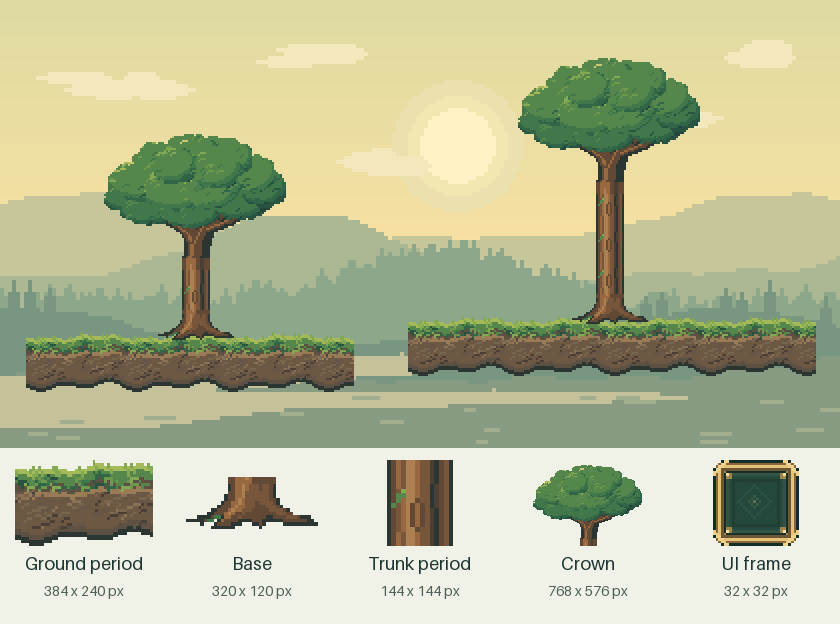
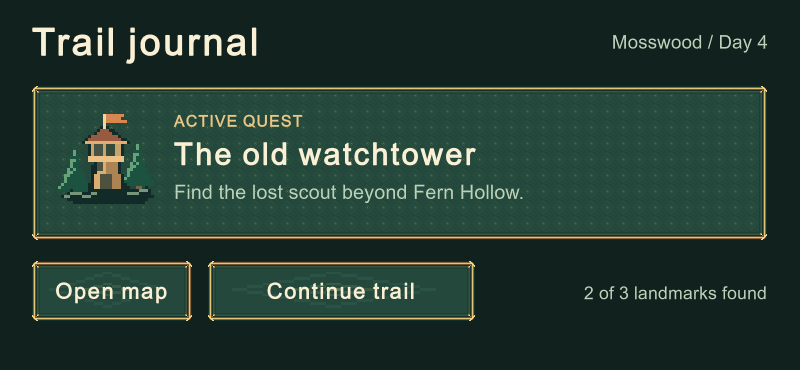
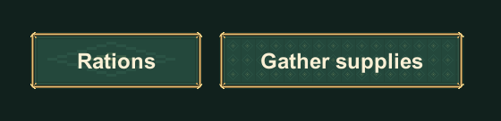
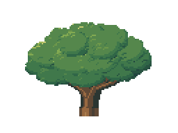
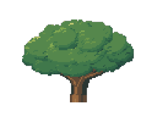
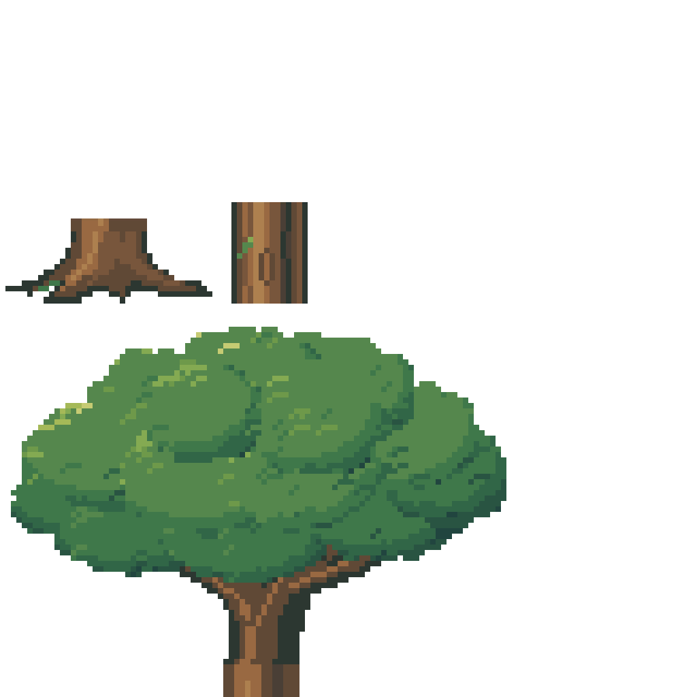

# Woodland image optimization examples



Both ledges use the same 384 × 240 ground sprite. At 1,000 authored pixels per meter, its horizontal pattern repeats every 0.384 m. The ledges are 1.312 m and 1.632 m wide, so both end partway through a tile. The trees share one base, one 144 × 144 trunk period and one crown. Their trunk renderers are 0.160 m and 0.400 m tall. Only the body repeats. The crown moves up with the upper join.

Import [Woodland.unitypackage](Captures/Woodland.unitypackage) into a Unity project to try it directly. It includes the prefab, its five world PNGs and their importer settings. The replay also saves an editable `Assets/ImageExamples/Woodland.prefab` in its Unity receiver. Inspect the ledges and trunks, then change the **Size** field on a Tiled, Continuous SpriteRenderer. Keep the Transform at unit scale. When changing tree height manually, move the crown to the new join. The native test reopens the prefab, changes the ground width and trunk height by one period, and checks the resulting bounds. [World art](../../unity-performance-skill/assets/image-optimization/Art/World) · [World renderer and checks](../../unity-performance-skill/assets/image-optimization/Editor/WorldArtExample.cs)

## One backing for a panel and two buttons



A 735 × 154 panel and two buttons measuring 160 × 60 and 267 × 60 share one 32 × 32 backing with eight-pixel borders. UI Toolkit tiles the patterned panel center and stretches the button centers to fit their labels. The 32 × 32 watchtower icon is a separate sprite. The replay presses both buttons near their extended edges and checks their callbacks. The Canvas capture below uses the same backing on sliced and tiled uGUI buttons. Its raycaster checks both extended hit regions. Both hosts also check the rendered corner pixels and the center pattern’s 16-pixel repeat. [Frame and icon](../../unity-performance-skill/assets/image-optimization/Art/UI) · [UI implementation](../../unity-performance-skill/assets/image-optimization/Editor/ControlArtExample.cs) · [Packaged stylesheet](../../unity-ui-skill/assets/ResizableBacking.uss)



## Import size at the game camera

The import study renders an isolated copy of the crown twice with the same camera and world size. The baseline uses 100 PPU and a 0.1 renderer scale. The candidate uses 1,000 authored PPU and unit scale. The importer chooses the target cap from the crown’s largest projected footprint of 192 × 144 pixels. On Unity 6000.6.7f1 with the macOS Standalone target, the imported texture went from 768 × 576 to 256 × 192. Its measured Editor texture-object allocation fell from 3,539,952 to 394,224 bytes (88.9%). Both renders covered 0.768 × 0.576 meters and their visible silhouettes overlapped by 99.965%. [Native measurements](Captures/ImportAtlas.json) · [Import and atlas implementation](../../unity-performance-skill/assets/image-optimization/Editor/ImportAtlasExample.cs)

| Original import | Display-sized import |
| --- | --- |
|  |  |

## The packed tree page



Unity packed the crown, trunk and base from three source textures onto one 1024 × 1024 DXT5 Sprite Atlas page. The ground stays outside the atlas so that using the tree does not pull in ground artwork. The replay reads the packed texture from Unity, checks each sprite's binding and non-overlapping rectangle, then exports that page. The measurements include page dimensions, format and sprite rectangles. A device residency or draw-call claim needs a run on the receiving game's target.

## Reproduce the captures

Follow the [installed replay instructions](../../unity-performance-skill/references/performance-cases.md#replay-the-image-optimization-examples). The pack includes the original [artwork](../../unity-performance-skill/assets/image-optimization/Art), Editor fixtures, importer and stylesheet. Each run creates a fresh project and writes native frames, the editable woodland package, import measurements and a source-and-output receipt to `<task-run>/<run-name>/captures/`. See the [two-run comparison](Captures/Repeatability.json).

When working from this checkout, [replay.py](replay.py) also launches the packaged runner. To add the source strip below a native world frame, run the gallery helper from the repository root with Pillow 10.1 or later.

```text
python3 -B examples/image-optimization/annotate.py "<task-run>/first/captures"
```

The source strip uses independently scaled previews of the original PNGs. The gameplay and UI frames come from Unity. [Replay receipt](Captures/Replay.json)
